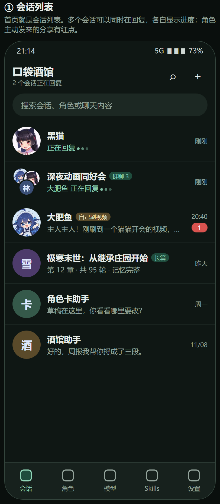
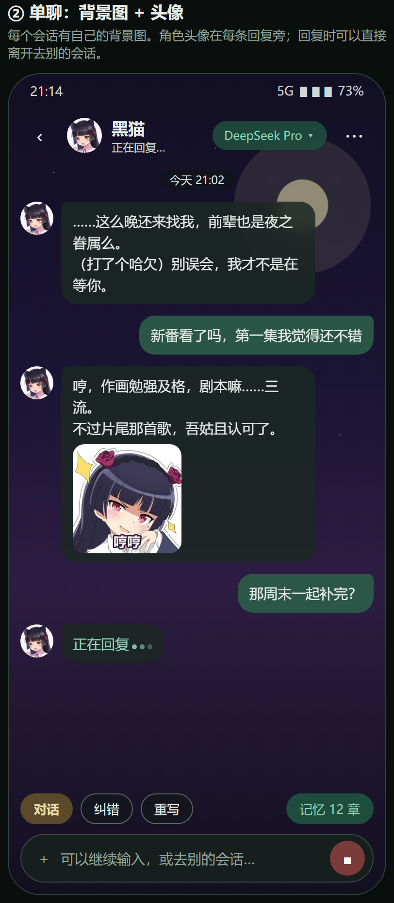
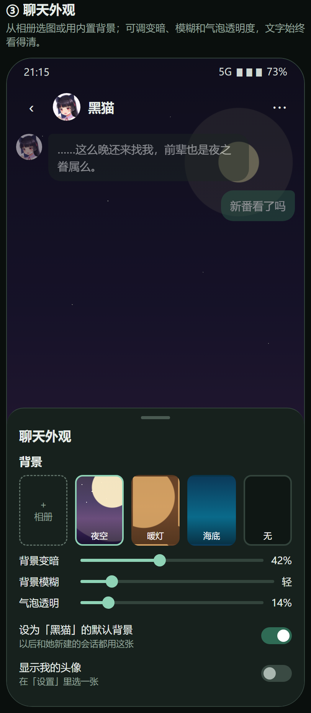
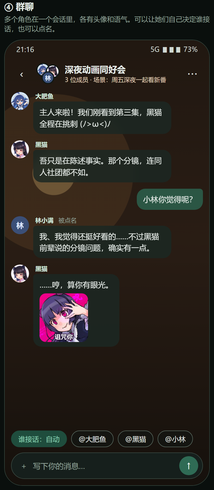
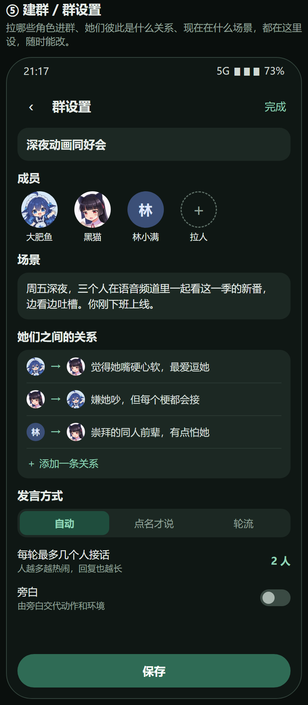
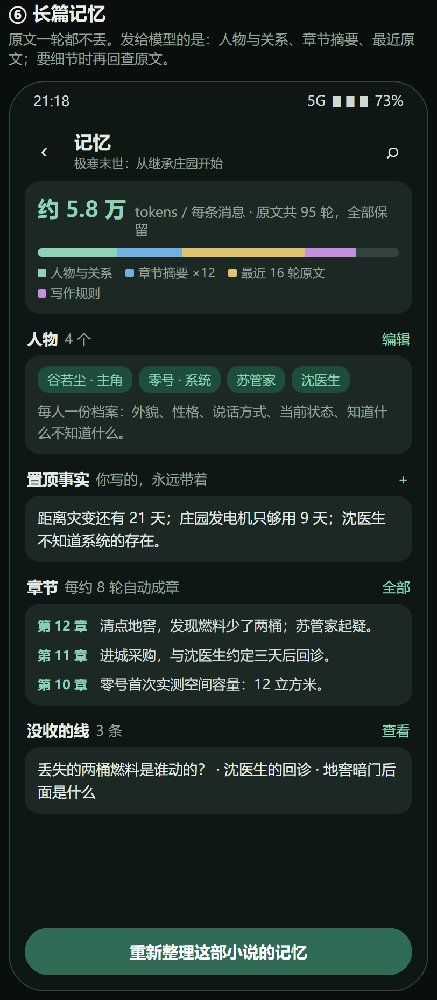

# 口袋酒馆重设计（0.2 系列）

状态：**用户已确认（2026-11-12），按第 5 节分步交付。** 第 1–3 步（0.2.0、0.2.1、0.2.2）已完成，第 4 步（群聊）未开工。

要解决的事，都是用户提的：

1. 一个会话在等回复时，其他会话和设置都用不了。
2. 每个聊天能设背景图。
3. 每个角色有自己的头像。
4. 能把多个角色拉进一个群，设置她们之间的关系和场景。
5. 长篇小说：历史一轮都不能丢，同时还要写得好。不接受“开新会话”。

设计稿总览：[overview.png](overview.png)，可交互的网页版：[index.html](index.html)。

---

## 1. 会话列表和多会话同时生成

- **首页改成会话列表。** 现在会话藏在左上角的抽屉里；改成像聊天软件一样的列表：头像、名字、最后一句话、时间。
- **每个会话各自生成，互不阻塞。**
  - 一个会话在回复时，可以切到别的会话继续聊，也可以去改设置、换模型、编辑角色。改动从下一条消息起生效。
  - 列表里正在回复的会话显示“正在回复…”；顶部显示有几个在进行。
  - 停止按钮只停当前这个会话。
  - 同时生成的会话默认最多 3 个，超过的排队。原因：上游有频率限制，而且每个都在计费。
- **仍然需要独占的操作**：恢复备份、导入数据。这时会提示“有 N 个会话正在回复，先停止还是等待”。正在回复的会话不能被删除，它用的模型也不能中途换。
- **角色主动发来的消息**（自己刷视频）在列表里显示红点。

## 2. 聊天界面：背景图和头像

 

- **背景图按会话保存。** 从相册选图，或用内置的几张（夜空、暖灯、海底）；也可以不用。
  - 可以调“背景变暗”“背景模糊”“气泡透明度”，保证文字看得清。
  - 可以把一张图设为某个角色的默认背景，以后和她新建的会话自动用它。
  - 图片存在手机上，随备份一起走。
- **头像。**
  - 角色头像 0.1.83 已经做了：角色卡上、每条回复旁都有。
  - 新增“我的头像”（可选），在设置里选一张。
  - 群聊的头像由成员头像自动拼成。
- 顶栏显示角色头像、名字和当前模型；“记忆 12 章”按钮直接进这个会话的记忆页。

## 3. 群聊

 

- **建群**：在会话列表点“＋”→“新建群聊”，从角色里选 2–6 个成员，填群名。
- **场景**：一段文字，说明现在在哪、在做什么。随时能改，改了以后的回复就按新场景来。
- **关系**：一条一条写“谁对谁怎么看”，比如“大肥鱼 → 黑猫：觉得她嘴硬心软，最爱逗她”。也可以写她们各自和你的关系。
- **谁接话**有三种方式，输入框上方可以随时切换：
  - **自动**：模型按话题、性格和关系决定谁说话，一轮最多几个人可设（默认 2）。
  - **点名**：发消息前点一下“@黑猫”，就只有她回答。
  - **轮流**：按顺序每人说一句。
- **每个角色保持自己的样子**：各用各的角色卡、头像和专属表情包，回复拆成各自的气泡。
- **费用**：一条用户消息只调用一次模型，由它一次写出这一轮几个人的话，App 再按说话人拆开。所以花费和单聊差不多，只是回复更长。
- **记忆**：群聊用同一套长篇记忆（见下一节）。群里发生的事只在这个群里；角色在别的单聊里并不知道。
- 旁白（可选）：打开后由旁白交代动作和环境。

## 4. 长篇记忆：历史不丢，也要写得好

### 现在的问题出在哪

查了电脑上的请求记录（只看大小和构成）：

- 你的长篇会话每条消息发送约 21.4 万 tokens，从 2.3 万一路涨上来，一次都没有压缩过。
- App 本来就有“摘要 + 知识库 + 按需回查原文”这套机制，但它是按“总量是否超过输入预算”触发的。
- Skill 的正文算在总量里。这个会话开了 11 个 Skill，按 App 自己的估算，Skill 加固定规则就占约 5.6 万 tokens，默认 6.5 万的预算里几乎没给历史留位置。
- 这种情况下只有把预算调大或填 0（等于模型的 100 万上限）才能继续发消息。从记录推断手机上就是这样设的：预算一放开，压缩就再也不触发了。
- 结果是全部原文、全部工具返回、全部 Skill 每次都原样发给模型。上下文越长，模型越容易前后矛盾、忘记设定。

所以问题不是“历史太长”，而是 App 没有把长历史整理好再交给模型。这是 App 该做的事。

### 新的做法

**原文永远完整保存在手机里，任何时候都能翻、能搜。** 变的只是每次发给模型的内容，分四层：

| 层 | 内容 | 谁维护 |
|---|---|---|
| 人物与关系 | 每个人物一份档案：外貌、性格、说话方式、当前状态、知道什么不知道什么；人物之间的关系 | 自动整理，你可以改 |
| 置顶事实 | 你认为绝不能错的事 | 你写，永远带着 |
| 章节摘要 | 每约 8 轮自动成一章，记下发生了什么、数字、约定、没收的线 | 自动，你可以改 |
| 最近原文 | 最近 16 轮左右的完整原文 | 自动 |

另外，模型需要某个细节时，可以回查原文（现有的 `history_search` / `history_read`），查到的是你当时写下的原话。

关键改动：

- **记忆和 Skill 分开算。** 历史达到一定长度就整理成章节，不管开了多少 Skill，也不管输入预算填的是多少。预算填 0 不再等于“永不压缩”。
- **记忆页**（上图）告诉你每条消息实际发了多少、由哪几部分组成、模型现在“记得”什么。哪里记错了可以直接改。
- **旧会话一键整理。** 已经写了 95 轮的那部小说不用重开：点“重新整理这部小说的记忆”，App 通读全部原文，生成人物档案和章节摘要。这一步要调用几次模型，会有一次性的费用；原文不动。
- **工具返回不再反复发送。** 0.1.83 已经处理了联网搜索的原文；这次把读取 Skill 参考文件等其他工具结果也按同样规则清理。
- **Skill 的开销看得见。** 记忆页和 Skill 选择器显示每个 Skill 占多少；同时开了几个“整套引擎”类的 Skill 时给出提醒（它们的规则会互相冲突），但不强制关闭。

### 我能保证和不能保证的

- 能保证：原文不丢；每条消息的大小稳定在几万 tokens，不随小说变长而膨胀；模型看到的内容在记忆页里一清二楚。
- 不能保证：摘要一定不漏细节。对策是置顶事实、可编辑的人物档案和按需回查原文。
- 不能保证：模型本身的文笔。记忆整理好之后，如果还觉得逻辑差，可以在同一个会话里换更大的模型对比，这次并发改造后切换模型也更方便。

## 5. 分步交付

每一步都是一个能装的版本，做完一步给你验收一步。

| 步骤 | 版本 | 内容 |
|---|---|---|
| 1 | 0.2.0（已完成） | 多会话同时生成；首页改成会话列表 |
| 2 | 0.2.1（已完成） | 长篇记忆：记忆和 Skill 分开算、记忆页、旧会话一键整理、工具结果清理 |
| 3 | 0.2.2（已完成） | 聊天背景、我的头像、聊天界面翻新 |
| 4 | 0.2.3 | 群聊：成员、场景、关系、三种接话方式 |

顺序可以调。我把并发和长篇记忆排在前面，因为这两件是现在最影响使用的。

## 6. 数据和兼容

- 现有会话、角色、设置全部保留，升级后直接可用。
- 会话新增：背景图、成员列表（群聊）、场景、关系、接话方式、章节。旧数据读进来这些都是空的。
- 背景图和“我的头像”存在手机本地，随备份导出和恢复。
- 群聊仍然只在手机上保存，电脑端不需要改动。
